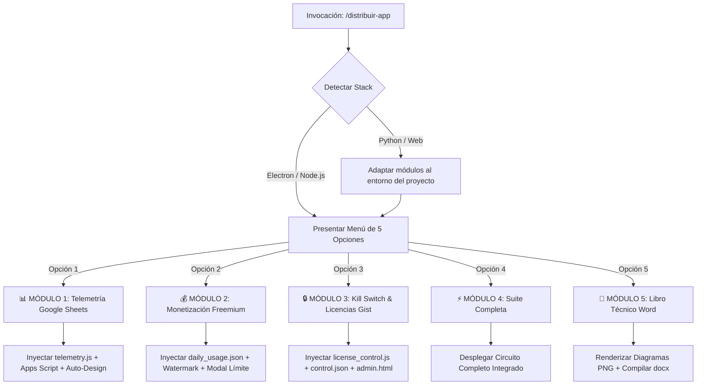

# /distribuir-app - Menú Interactivo de Distribución, Telemetría y Monetización

Esta skill actúa como un **consultor y orquestador interactivo** para monetizar, auditar y proteger aplicaciones antes o durante su distribución masiva. Al invocarse, evalúa el stack del proyecto y presenta un menú con 4 módulos independientes o combinables a elección del usuario.

---

## 🎯 Menú de Módulos Disponibles

Al ejecutar `/distribuir-app`, muestra este menú al usuario para que elija el módulo que desea implementar o auditar:

```
┌───────────────────────────────────────────────────────────────────────────┐
│              🚀 MENÚ MODULAR DE DISTRIBUCIÓN Y MONETIZACIÓN               │
├───────────────────────────────────────────────────────────────────────────┤
│ [1] 📊 Telemetría y Flota (Google Sheets $0)                             │
│     • Conteo de máquinas únicas (Machine ID anónimo por hardware).        │
│     • Google Apps Script webhook (doPost) con diseño automático.          │
│     • Registro de sesiones, minutos acumulados y alertas condicionales.   │
├───────────────────────────────────────────────────────────────────────────┤
│ [2] 💰 Motor Freemium y Límites de Uso                                    │
│     • Contador diario con reseteo automático a medianoche (%APPDATA%).    │
│     • Límite configurable (ej. 3 clips/exportaciones por día).            │
│     • Marca de agua condicional integrada en el motor de renderizado.     │
│     • Modal emergente de "Límite Alcanzado" con llamada a la acción.      │
├───────────────────────────────────────────────────────────────────────────┤
│ [3] 🔒 Kill Switch y Control de Licencias PRO                             │
│     • Control remoto desacoplado vía GitHub Gist (control.json).          │
│     • Licencias PRO por Machine ID o modo global (comodín "*").           │
│     • Persistencia anti-bypass offline (license_lock.json).               │
│     • Panel de administración desacoplado (admin.html) con token PAT.     │
├───────────────────────────────────────────────────────────────────────────┤
│ [4] ⚡ Suite Completa de Lanzamiento (1 + 2 + 3)                          │
│     • Integra Telemetría + Monetización + Kill Switch en un solo paso.    │
├───────────────────────────────────────────────────────────────────────────┤
│ [5] 📖 Compilación de Libro y Tutorial Técnico (.docx + Diagramas)       │
│     • Genera documentación dual (Markdown + Word) con diagramas visuales  │
│       incrustados en alta resolución mediante Pillow.                     │
└───────────────────────────────────────────────────────────────────────────┘
```

---

## 📋 Arquitectura y Flujo de Decisión



---

## 🛠️ Especificación Técnica por Módulo

### Módulo 1: Telemetría con Google Sheets ($0)
- **Generación de ID:** SHA-256 basado en `os.hostname()`, `os.platform()`, CPU model y RAM total.
- **Persistencia Local:** `%APPDATA%\<app_name>\telemetry_id.json`.
- **Apps Script Receptor:**
  - `doPost(e)`: Lee `JSON.parse(e.postData.contents)`, busca la fila del `machine_id` o inserta nueva fila.
  - `disenarHojaAutomatica()`: Formatea encabezados oscuros, bordes, colores condicionales para *power users* y auto-ajuste de columnas.
- **Advertencia Clave:** Explicar al usuario que `doPost` jamás se ejecuta con el botón `▷ Ejecutar` del editor de Google (arroja `TypeError: Cannot read postData`), sino que es activado vía peticiones HTTP de la app.

### Módulo 2: Motor de Monetización Freemium
- **Almacén de Uso:** `%APPDATA%\<app_name>\daily_usage.json`.
  ```json
  {
    "date": "2026-11-27",
    "clipsExportedToday": 2,
    "maxFreeClipsPerDay": 3
  }
  ```
- **Lógica de Medianoche:** Si `new Date().toISOString().slice(0, 10) !== data.date`, el contador vuelve a `0`.
- **Renderizado Condicional:** En el motor FFmpeg/Python, inyectar el filtro de texto o marca de agua únicamente si `is_pro === false`.
- **Experiencia de Usuario:** Indicador visual en cabecera (`🎬 Clips hoy: X / 3`) y modal bloqueante al 4to intento con botón hacia pasarela o WhatsApp.

### Módulo 3: Kill Switch Remoto y Licencias PRO
- **Plano de Control:** GitHub Gist público/secreto con archivo `control.json`.
- **Estructura del Control:**
  ```json
  {
    "global_active": true,
    "kill_message": "Servicio en mantenimiento.",
    "blocked_machines": [],
    "pro_machines": ["*"]
  }
  ```
  *(El comodín `"*"` activa modo PRO para toda la flota en campañas o eventos).*
- **Persistencia Anti-Bypass:** Al recibir bloqueo, se escribe `%APPDATA%\license_lock.json`. La app nace bloqueada aunque el usuario desconecte el cable de red.
- **Consola Maestra:** `admin.html` desacoplada del instalador del cliente con token Personal Access Token (PAT) guardado en `localStorage`.

---

## 🛡️ Protocolo de Seguridad y Anti-Regresión

1. **Separación de Dominios:** El cliente final solo contiene peticiones de lectura (`GET` a Gist y `POST` a Apps Script). El token de administración (`PAT`) jamás se empaqueta en el ejecutable del cliente.
2. **Tolerancia a Fallos:** Si GitHub o Google Sheets se caen o el usuario está sin conexión, la app debe permitir el uso normal de cortesía (a menos que exista un bloqueo previo en `license_lock.json`).
3. **Reseteo Determinista de Medianoche:** El reseteo del contador diario debe basarse en formato ISO `YYYY-MM-DD` para evitar desfases de zona horaria.
