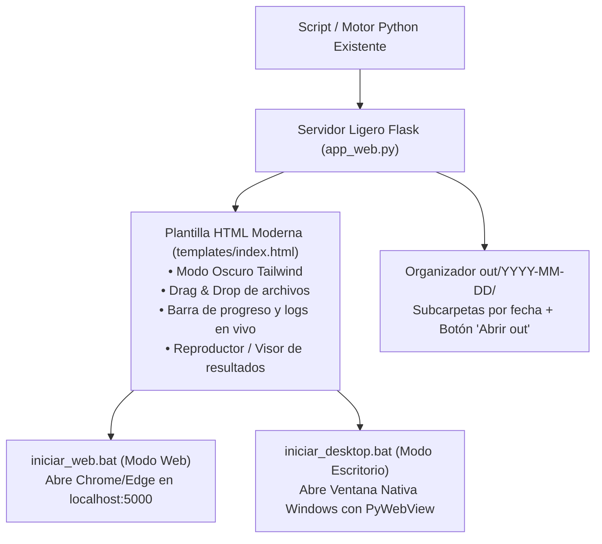

---
name: gui-dual
description: Convierte cualquier script o proceso de Python en una suite visual moderna con arquitectura dual (Web con Flask + Ventana PyWebView). Alias: /interfaz-dual
---

# /gui-dual - Generador de Interfaces Modernas Duales (Web & Escritorio) para Python

Esta skill dota a cualquier script, herramienta CLI o proceso en segundo plano de Python de una **interfaz gráfica moderna dual**, permitiendo ejecutar la misma aplicación tanto en el navegador (Flask) como en una ventana independiente de escritorio (PyWebView) con cero duplicación de código.

---

## 📋 Ficha de Compatibilidad y Requisitos

- **Stack Compatible:** Python (3.9+)
- **Dependencias Python:** `flask`, `pywebview`
- **Frontend:** HTML5 semántico, Tailwind CSS (CDN), Vanilla JavaScript interactivo (sin node_modules pesados).
- **Entorno:** Windows / POSIX (con lanzadores `.bat` automáticos para Windows).

---

## 🏛️ Arquitectura de la Solución Dual



---

## 🛠️ Procedimiento de Implementación en 5 Pasos

Cuando el usuario pida `/gui-dual` o transformar un script en aplicación visual:

### 1. Auditar Entorno y Requisitos
Verificar que existan `flask` y `pywebview` en `requirements.txt`. Si no están, agregarlos:
```text
flask
pywebview
```

### 2. Crear el Backend (`app_web.py`)
Diseñar el servidor Flask con:
- Estado en memoria线程 seguro (`state_lock = threading.Lock()`) con `progress`, `status`, `logs` y `generated_files`.
- Hilo asíncrono para no congelar la UI mientras corre la tarea intensiva.
- Endpoint `/api/open-output-folder`:
  ```python
  @app.route("/api/open-output-folder", methods=["POST"])
  def open_output_folder():
      ruta = os.path.abspath("out")
      os.makedirs(ruta, exist_ok=True)
      if os.name == 'nt':
          os.startfile(ruta)
      return jsonify({"success": True, "path": ruta})
  ```
- Endpoint `/api/status` para polling o SSE de la barra de progreso y logs.
- Rutas para servir archivos generados (`send_file`).

### 3. Crear el Envoltorio de Escritorio (`app_desktop.py`)
Reutiliza la instancia Flask directamente dentro de la ventana de escritorio:
```python
import sys
import os

try:
    import webview
except ImportError:
    import subprocess
    subprocess.check_call([sys.executable, "-m", "pip", "install", "pywebview"])
    import webview

from app_web import app

if __name__ == "__main__":
    window = webview.create_window(
        title="Mi Aplicación - Studio",
        url=app,
        width=1280,
        height=850,
        resizable=True,
        min_size=(960, 680)
    )
    webview.start()
```

### 4. Crear la Interfaz HTML (`templates/index.html`)
Diseñar con Tailwind CSS en modo oscuro:
- Cabecera con título, badge de estado animado (`animate-pulse`), botón **`[📂 Abrir Carpeta out]`** y botón de limpiar caché.
- Panel izquierdo: Formulario de configuración, Dropzone de archivos con Drag & Drop, botones de inicio y detención, barra de progreso porcentual.
- Panel derecho: Pestañas para visor de datos/items, reproductor/visualizador de resultados generados y terminal de logs en tiempo real con scroll automático.

### 5. Estructura Limpia de Salidas y Lanzadores `.bat`
- Rutas de salida siempre agrupadas en: `os.path.join("out", datetime.now().strftime("%Y-%m-%d"), subcarpeta)`
- Asegurar `out/` en `.gitignore`.
- Lanzadores portables:
  - `iniciar_web.bat` (`python app_web.py`)
  - `iniciar_desktop.bat` (`python app_desktop.py`)

---

## 🛡️ Protocolo Anti-Regresión
1. **Nunca tocar el algoritmo de cálculo o procesamiento original:** La lógica pesada de Python debe ser llamada intacta en una función worker o hilo desacoplado.
2. **Protección de Puertos:** Si el puerto 5000 está ocupado, permitir fallback dinámico o aviso amigable.
3. **Manejo de Bloqueos en Windows:** Usar identificadores únicos o PIDs para archivos temporales evitando el error `PermissionError: [WinError 32]`.
